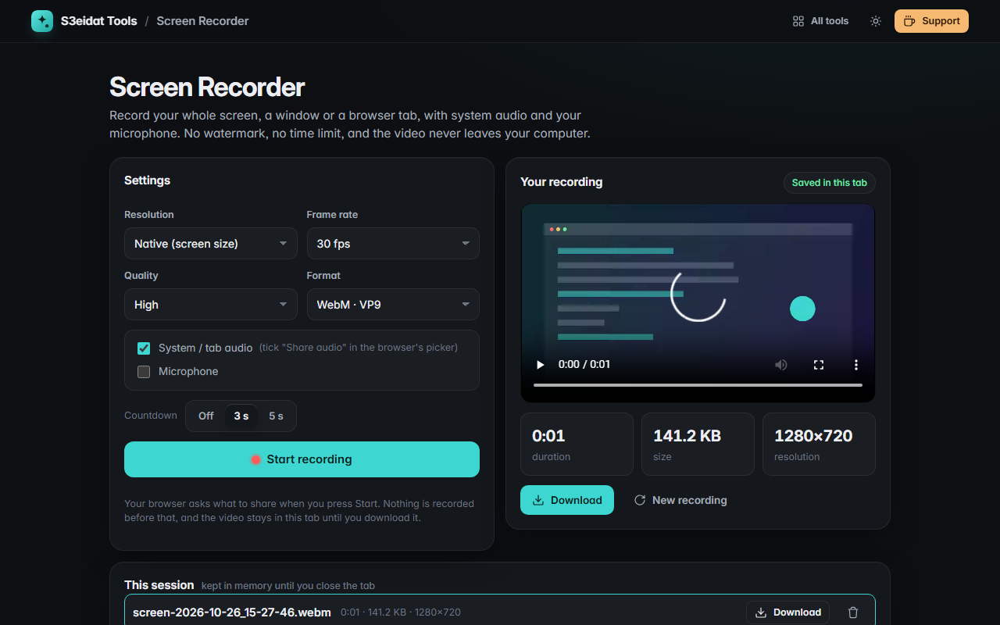

# Screen Recorder

> Record your screen, a window or a tab with system audio and your microphone. Free, private, and it runs entirely in your browser.

### ▶ [Open Screen Recorder](https://s3eidat.github.io/screen-recorder/)



## Features

- Record the **whole screen, one window or a browser tab** (your browser's own picker)
- **System / tab audio** and your **microphone**, mixed together with a separate mic volume
- Choose **resolution** (native, 1080p, 720p), **frame rate** (15/30/60) and **quality**
- **Countdown** (off, 3 s, 5 s), live **timer** and file size, **pause / resume**
- **Preview** the recording right away, then **download WebM**, or **MP4** when your browser can record it
- Every take of the session is listed so you can re-watch, download or remove it
- **No watermark, no time limit, no sign-up**

Screen capture needs a desktop browser (Chrome, Edge, Firefox, Safari). iPhone, iPad and Android
browsers don't let websites record the screen; the page tells you so instead of failing silently.

## Privacy

The recording never leaves your device. It's held in the tab's memory until you download it.
There is no server, no account, no analytics. The page ships with a strict Content-Security-Policy
(`connect-src 'self'`), so the browser itself blocks any attempt to send data anywhere. The screen and
microphone are only requested when you press **Start recording**.

## Run it yourself

It's plain HTML, CSS and JavaScript with no build step:

```bash
git clone https://github.com/s3eidat/screen-recorder
cd screen-recorder
python -m http.server 8000
```

Then open http://localhost:8000 (screen capture needs `localhost` or HTTPS).

## Support

If this saved you time, **[buy me a coffee ☕](https://s3eidat.github.io/coffee/)**. It keeps every tool free.

---

Part of **[S3eidat Tools](https://s3eidat.github.io/)**: 100+ free, private tools that run in your browser. MIT licensed.
